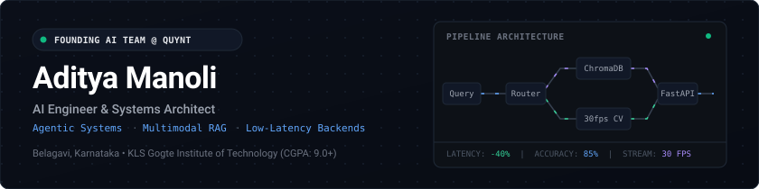
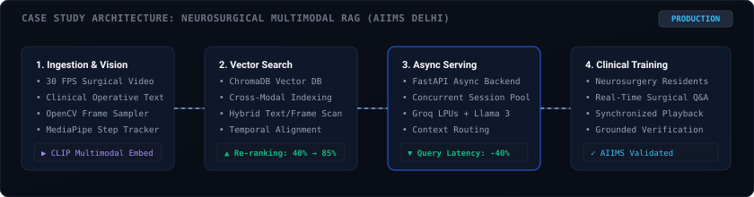

  <!-- Minimalist High-End Architecture Hero Banner -->
  

    

  <!-- Unified Dark Action Links -->
  
  &nbsp;
  
  &nbsp;
  
  &nbsp;
  
  &nbsp;
  

 

---

### Overview

I am an **AI Engineer** specializing in **agentic AI workflows, multimodal RAG pipelines, and low-latency FastAPI architectures**. Currently, I work on foundational AI product development as part of the **Founding AI Team at QUYNT**.

My focus centers on the operational boundary between machine learning research and resilient production software. Rather than building static wrappers around API endpoints, I architect autonomous systems with deterministic routing, verified vector retrieval, and high-concurrency asynchronous backends.

* **Production Systems:** Deployed a multimodal surgical retrieval system for neurosurgery residents at **AIIMS Delhi** (cutting query latency by 40% and raising answer accuracy to 85%).
* **Security & Automation:** Built autonomous VAPT security testing agents with PentestGPT and CXO financial intelligence agents at **NextWealth**.
* **Academic Grounding:** Computer Science undergrad at **KLS Gogte Institute of Technology** (CGPA: 9.0+, graduating Aug 2026).

---

### Professional Experience

#### **AI Developer — Founding AI Team** &nbsp;•&nbsp; [QUYNT](https://quynt.com)
*Jul 2026 – Present &nbsp;|&nbsp; India*
- Contributing to core AI product development from initial architecture through deployment as a founding member of the AI team.
- Architecting modular agentic pipelines and asynchronous microservices designed for enterprise-scale traffic.

#### **IT Intern** &nbsp;•&nbsp; [NextWealth Entrepreneurs](https://nextwealth.in)
*May 2026 – Jul 2026 &nbsp;|&nbsp; Bangalore, India*
- **Autonomous VAPT Harness:** Engineered an end-to-end automated penetration testing prototype utilizing PentestGPT, Python, FastAPI, React, and Tailwind CSS. Streamlined workflows from temporary URL ingestion to autonomous vulnerability scanning and executive report generation; led a fellow intern during development.
- **Zoho Zia Financial Agents:** Implemented conversational financial analysis workflows within Zoho's native Zia Agents ecosystem, ingesting analyst spreadsheets from Zoho WorkDrive to enable CXOs to query multi-period performance figures.

#### **SDE Intern** &nbsp;•&nbsp; Tech Fortune Technologies
*Jan 2026 – May 2026 &nbsp;|&nbsp; Belagavi, India*
- Designed and instructed practical Python, AI/ML, and Agentic AI curricula for **150–200 students** across engineering and computer application disciplines.
- Created **CodeExplainer**, an interactive code comprehension and auto-documentation tool powered by Streamlit and Groq API.

#### **AI Research Intern** &nbsp;•&nbsp; [All India Institute of Medical Sciences (AIIMS)](https://www.aiims.edu)
*May 2025 – Sep 2025 &nbsp;|&nbsp; New Delhi, India*
- **Multimodal Surgical RAG:** Built a production-grade multimodal retrieval engine using CLIP embeddings and ChromaDB across operative video footage and clinical transcripts for neurosurgery resident education.
- **Latency Reduction:** Optimized backend query serving via an async FastAPI layer integrated with Groq API and Llama models, reducing inference latency by **40%** under concurrent load.
- **Real-Time CV Pipeline:** Designed an OpenCV and MediaPipe processing pipeline running at **30 FPS** for surgical phase tracking and live contextual Q&amp;A.
- **Accuracy Optimization:** Raised response precision from **40% → 85%** through rigorous prompt engineering, embedding fine-tuning, and retrieval re-ranking.

#### **Project Trainee** &nbsp;•&nbsp; [Indian Institute of Technology (IIT) Delhi](https://home.iitd.ac.in)
*Jun 2024 &nbsp;|&nbsp; New Delhi, India*
- Implemented ML models for computer vision research; profiled and benchmarked inference pipelines on resource-constrained embedded hardware.

---

### Featured Architecture & Case Studies

#### 1. Neurosurgical Multimodal RAG Pipeline *(AIIMS Delhi)*
> *Production multimodal retrieval and question-answering system deployed for neurosurgical training.*

  

- **Frame & Transcript Synchrony:** Continuously samples surgical video feeds, projects frame representations into shared CLIP semantic space with operative text, and indexes dense vectors in ChromaDB.
- **Asynchronous Execution:** Async FastAPI endpoints stream context through Groq-accelerated Llama models, cutting query turnarounds by 40% while preserving clinical rigor with 85% answer accuracy.
- **Technologies:** `Python` · `FastAPI` · `CLIP` · `ChromaDB` · `OpenCV` · `MediaPipe` · `Groq Cloud` · `Llama 3`

---

#### 2. Autonomous Web Application VAPT Pipeline *(NextWealth)*
- Built an offensive security automation pipeline leveraging PentestGPT as the core reasoning engine.
- Translates dynamic application endpoints into structured reconnaissance tasks, detects security vulnerabilities in temporary vibe-coded deployments, and outputs comprehensive remediation reports.
- **Technologies:** `Python` · `FastAPI` · `PentestGPT` · `React` · `Tailwind CSS` · `Subprocess Asyncio`

---

#### 3. Research Literature Analyzer *(Avalanche '24 Hackathon — 2nd Place)*
- Fully offline multi-agent RAG system built in under 24 hours (ranked **2nd out of 60+ engineering teams**).
- Deploys specialized CrewAI agents that retrieve, cross-reference, and summarize complex research papers using local ChromaDB vector search and Ollama inference, without external API calls or telemetry.
- **Technologies:** `CrewAI` · `ChromaDB` · `Ollama` · `LangChain` · `FastAPI`

---

#### 4. Real-Time Driver Drowsiness Detection *(GirlGeekHack '24 — 2nd Place)*
- Real-time computer vision pipeline tracking facial landmarks and Eye Aspect Ratio (EAR) at **30 FPS**.
- Outperformed 50+ competing teams with sub-100ms micro-sleep detection algorithms calibrated for edge hardware.
- **Technologies:** `Python` · `OpenCV` · `MediaPipe` · `NumPy`

---

### Technical Capabilities

| Domain | Core Competencies &amp; Tooling |
| :--- | :--- |
| **Agentic AI &amp; LLM Orchestration** | `LangGraph` &nbsp;·&nbsp; `CrewAI` &nbsp;·&nbsp; `LangChain` &nbsp;·&nbsp; `Agno` &nbsp;·&nbsp; `Autonomous Multi-Agent Systems` |
| **Models &amp; Low-Latency Inference** | `Groq Cloud (LPU)` &nbsp;·&nbsp; `Llama 3 / 3.1` &nbsp;·&nbsp; `Qwen` &nbsp;·&nbsp; `Ollama` &nbsp;·&nbsp; `Hugging Face Transformers` |
| **Retrieval &amp; Vector Databases** | `ChromaDB` &nbsp;·&nbsp; `CLIP Multimodal Embeddings` &nbsp;·&nbsp; `Hybrid Search` &nbsp;·&nbsp; `Contextual Re-Ranking` |
| **Backend &amp; API Concurrency** | `Python (AsyncIO)` &nbsp;·&nbsp; `FastAPI` &nbsp;·&nbsp; `REST APIs` &nbsp;·&nbsp; `Streamlit` &nbsp;·&nbsp; `Uvicorn` &nbsp;·&nbsp; `Pydantic` |
| **Computer Vision &amp; Multimodal** | `PyTorch` &nbsp;·&nbsp; `OpenCV` &nbsp;·&nbsp; `MediaPipe (30 FPS)` &nbsp;·&nbsp; `Video Stream Processing` |
| **DevOps &amp; Infrastructure** | `Docker` &nbsp;·&nbsp; `Git` &nbsp;·&nbsp; `GitHub Actions` &nbsp;·&nbsp; `Linux` &nbsp;·&nbsp; `PentestGPT` |

 

  
  
  
  
  
  
  

---

### Honors &amp; Leadership

- **🥈 2nd Place** — Avalanche '24 Hackathon *(Agentic AI / Local RAG, 60+ teams)*
- **🥈 2nd Place** — GirlGeekHack '24 *(Edge Computer Vision, 50+ teams)*
- **🥉 3rd Place** — ACM NEXUS Hackathon *(Systems Engineering &amp; AI)*
- **Tech Lead** — *Machine Intellect Society* (Technical bootcamps, workshops, and hackathons)
- **Joint Secretary** — *UiPath Innovators Club* (Process automation and intelligent workflows)
- **Curriculum &amp; Mentorship** — Trained 150–200 students in Python and Agentic AI development

---

### Education

- **Bachelor of Engineering in Computer Science and Engineering** *(Expected Aug 2026)*  
  **KLS Gogte Institute of Technology**, Belagavi, Karnataka  
  **Academic Performance:** `CGPA: 9.0+ / 10.0`

---

Let's connect: <a href="mailto:manoliaditya@gmail.com">manoliaditya@gmail.com</a> &nbsp;•&nbsp; <a href="https://linkedin.com/in/adityamanoli">linkedin.com/in/adityamanoli</a>

